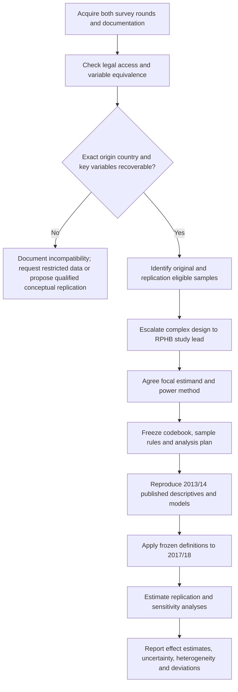

# Replication protocol: Kern et al. (2020), HBSC 2013/14 → 2017/18

**Status:** Pre-analysis working protocol, version 0.1 (23 October 2026)  
**Target paper:** Kern, M. R., Heinz, A., Stevens, G. W. J. M., Walsh, S. D., & Willems, H. (2020). “What’s a normal weight?” – Origin and receiving country influences on weight-status assessment among 1.5 and 2nd generation immigrant adolescents in Europe. *Social Science & Medicine, 264*, 113306. DOI: 10.1016/j.socscimed.2020.113306.  
**Original data:** HBSC 2013/14. **Independent replication candidate:** HBSC 2017/18.  
**Governance:** RPHB Secondary Data Power instructions. **No analyses should be described as preregistered until a dated protocol is deposited before access to replication outcomes.**

## Minimal reporting outputs — 27 October 2026

At the user's request, retain only power_assessment.md, comparison2014_2018.csv, country_fai.png and models2018.png in results/. Removed supporting/intermediate per-wave CSVs and duplicate reference/verification figures are no longer written by any execution mode. Working data remain in memory; the retained comparison CSV supplies reporting-only refreshes and actual analysis N for preliminary power. Raw files are unchanged. Earlier output inventories and historical file links are superseded by this policy.

## Current scope: paper replication only — 26 October 2026

The user requested replication without additional analyses. Active execution now contains 2014 verification, the two paper model structures, sample/descriptive reporting and the published-2014/fitted-2018 comparison. Added sensitivity models, formal coefficient contrasts and power simulations have been removed, along with the simulation CSV. Primary model tables, sample flow and coefficient figure were refreshed. The preliminary standard power calculation separately requested under Secondary data power.pdf remains, with assumptions stated.

Default execution verifies 2014 then analyses 2018. Both models currently use ML, so equivalence to the original IGLS/MCMC estimators is not claimed. Original settings, mappings and release differences remain issues to resolve for exact reproduction. This scope decision supersedes earlier instructions and historical implementation notes for added sensitivities, contrasts and simulations.

## Requested approximate-power benchmark — 26 October 2026

**Latest analysis update:** the user confirmed editorial approval and OSF registration complete, then requested full 2018 analysis after 2014 verification. `--replicate-2018` now implements an explicitly approximate ML temporal replication: primary unscreened WHO-LMS outcome, 2018 ISO origins, full-reference person-weighted sex centring, FAS quintiles from six 0-based items using country/age-category/sex midrank percentiles, age standardisation within sample, and at-least-one-known-native-parent indicator. Model 1 includes both country random intercepts; Model 2 adds both generation interactions but uses ML rather than the paper's Bayesian MCMC. These approximations are documented rather than claimed as author-equivalent methods.

Primary N=13,884, with 32 receiving and 43 origin groups. Receiving beta=.811 [.739,.883]; origin beta=-.031 [-.105,.044]; receiving-minus-origin=.842 [.734,.950], using normal intervals. Both primary fits converge without singularity; common-country sensitivity is singular and retains the random effect. Six Model 1 sensitivities cover z screening, combined GB, country-weighted centring, native-only standards, leave-one-out receiving means and common country coverage.

The PDF benchmark now uses the actual primary N: origin power 61.54% / 85.19%, receiving approximately 100% / 100%. Supplementary simulations use published 2014 Model 1 betas and variances (.002 receiving, 0 origin, .595 residual) with actual 2018 covariates/membership, seed 20261026, 200 attempts each at 75% and 100% of raw betas. Normal p<.05 rejection yields origin 99% / 100%, receiving 100% / 100%; Monte Carlo intervals and singular rates are reported. Boundary fits are not convergence failures. Raw-beta simulations and partial-r benchmarks are not interchangeable, and neither is a final lead-approved/design-complete power result. No fitted 2014 effects are claimed; 2014 origin/release limitations remain. Reporting tables/figure are linked in Section 8 of the existing assessment. This update supersedes earlier statements that no 2018 models had been run.

**Latest steering: 2014 verification first.** The user confirmed editorial approval and OSF registration are complete (URLs/dates pending). `--verify-2014` is an isolated original-wave verification path and does not run 2018 analysis. The 2014 codebook p.4 explicitly states that edition 1.1 removed Lithuanian data. Seven observed nonmissing counts match the dictionary and IDs are unique. Unscreened WHO-LMS FAI N=163,139; the provisional [-5,5] screen removes 257 further records. Naive individual-level intervals yield 36/40 girls above zero, 10/40 boys above and 23/40 below, compared with the paper's 37/41, 9/41 and 24/41; these are diagnostic, not verified survey-adjusted tests. Moldova has zero known migrants under generic coding despite 333 final immigrants in paper Table 1, so national coding/release exceptions need clarification, not just mapping of foreign category labels. The assessment records the exact missing evidence and a country coverage table/figure. No 2018 models have been run. Earlier statements that approval status is unconfirmed are superseded by the user's confirmation; original approval timing relative to descriptive exposure remains undocumented.

The user explicitly requested approximate power for the existing 2018 replication sample. `--power-only` now uses the existing complete-candidate-input N=13,858, k=9, approximate original SEs, and the supplied standard-regression recipe as a conditional benchmark. Original df=8,114 is an independent-observation assumption, not approved multilevel df. Origin partial r is approximately .02550: Tier 1 power 61.46%, Tier 2 85.13%. Receiving partial r is approximately .08794: both powers round to 100.00%. These do not establish design-adjusted power or project tier qualification. Both coefficients are reported without choosing a focal claim; contrast power remains unavailable. The linked Google Doc was inaccessible, so the supplied Secondary data power.pdf was used. Only Section 4 of the reviewed assessment is regenerated; participant files and outcomes are not reread. This supersedes earlier statements that the power-only mode never computes approximate power. Lead review and final usable N remain outstanding.

## Methodological audit clarification — 26 October 2026

The reviewed `results/power_assessment.md` now distinguishes conceptual equivalence from identical raw coding. For 2014, obtain and validate national birthplace mappings by receiving country, field and value, recover categories 2-5 where possible, and establish the authors' treatment of category 6. Do not assume that all foreign categories are irrecoverable, that category 6 is exclusively outside HBSC, or that restricted data are necessarily the only solution. The paper specifies the own/maternal/paternal hierarchy but does not document a common raw recode across 2014 and 2018. For 2018, validate ISO codes and use a separate harmonisation adapter before the same conceptual hierarchy. Existing counts remain provisional and are not recomputed in this audit.

The assessment is finalised for preliminary methodological consultation, not as completed power documentation. It lists study-lead decisions and analyst/provider tasks, including original eligibility, WHO/BMI scoring, FAS quintiles, age scaling, geography, missingness, independence, estimator/inference, partial-r conversion, usable N and power. Successful exact 2014 reproduction is not a universal gate for a diagnostic 2018 replication. Previous stronger language declaring the public file inherently unreproducible is superseded by this mapping-pending conclusion.

The reviewed Markdown is maintained directly rather than regenerated from boilerplate. `--power-only` now extracts published statistics without reading survey files or overwriting the assessment. The default full-sample entry point remains unsuitable for preapproval testing; the required random-5% mode is outstanding. No new outcome analyses, communications or OSF actions were performed. This clarification governs inconsistent historical implementation notes below.

## Implementation update — 26 October 2026

**Guidelines for Replicators alignment:** The supplied August 13, 2026 guidelines now qualify the workflow below. The COS-assigned claim must remain fixed (p.7); its precise assigned wording is not available here. Exact recreation of original conditions is not the priority (pp.1-3), so successful 2014 reproduction is not a universal gate for a diagnostic 2018 replication. The sequential original-first check remains a project choice, and measurement differences require explicit construct-validity justification.

Page 4 requires a random 5% replication-sample code test, with functionality evidence, and says not to run full-sample analysis code before editorial approval and OSF registration. Full-sample 2018 descriptive outcomes have already been inspected in this workspace; this exposure must be disclosed and its handling agreed with COS/editor. Approval/registration status is unconfirmed, and no documented random-5% test exists. Further full-sample outcome runs should wait for resolution; the current default script is not a compliant preapproval testing mode. The COS-provided Google Doc remains the preregistration version of record. Final materials are due 1 December 2026 according to the supplied document; project-specific receipt/approval dates are unknown. The existing power assessment records requirements, prior exposure and outstanding steps. No new outcome analyses, communications or OSF actions were performed for this documentation update. This clarification supersedes any earlier wording implying successful original reproduction alone determines 2018 eligibility or that the present outputs were produced results-blind.

The supplied `data/` directory has been inspected. Added `code/replication.R` and `README.md`; the script performs the first-stage raw-data audit for 2014 and 2018 and records its environment and input checksums. Earlier waves are outside this protocol's primary comparison. See README for the implementation boundary and run command.

**Section 3 stop rule triggered:** the 2014 codebook describes `m133`, `m134`, and `m135` as national categories 1–6, not exact origin-country identifiers (printed pp. 123–125). The 2018 `countryborn*` variables are labelled ISO 3166. Exact 2014 origins require national mappings and/or more detailed data; category 6 cannot be assigned an exact origin from the current fields. No confirmatory 2018 models or power calculations are authorised by the implementation. Audit counts are not eligible regression sample sizes. Gates G1–G7 remain unresolved; the versioned script and local audit outputs advance G8 only.

Raw replication inputs have been examined; no preregistration is claimed. Decisions about WHO scoring, age scaling, FAS quintiles, country mapping, centring, inference and power remain unresolved. The supplied article's median/SD wording for the BMI covariate also needs reconciliation with the intended WHO implementation. The R file contains explicitly uncalled downstream model helpers, not a completed confirmatory pipeline. The first-stage RPHB assessment and a study-lead escalation request are written locally to `results/power_assessment.md` and have not been sent.

### Power implementation update — 26 October 2026

Strict adherence to `Secondary data power.pdf` replaces the earlier hypothetical-N sensitivities. The script now reports published coefficient/CI evidence and approximate SEs, answers all six questions, and documents the PDF-required scientific-lead escalation for this non-standard design. It no longer substitutes individual residual df for effective multilevel df or reports naive partial correlations/power. The focal effect, defensible conversion and usable replication N remain unresolved. `--power-only` updates only the existing `results/power_assessment.md`; `--usable-n` is rejected because N alone cannot resolve the method. The PDF's standard-design recipe is documented for reference, not applied to an unapproved non-standard design. No new files are introduced.

### Output policy update — 26 October 2026

At the user's request, `results/` is reserved for power analyses, reporting tables and figures. Temporary codebook/article text extracts and five audit CSVs have been removed. Audit summaries remain reproducible from the R script in memory and console output; session information stays under `environment/`. This supersedes the audit-file destinations in the original folder recommendation and minimum-deliverable wording below. The existing power assessment retains the six RPHB answers and local escalation request. No inferential requirements or measurement gates change.

## 0. Decision diagram

**Sequential descriptive reproduction (26 October 2026):** The user requested 2014 verification before 2018. Default execution now computes 2014 reference FAI and sample diagnostics first, followed by qualified 2018 descriptives using identical WHO-LMS construction. The cached official WHO 2007 Month/L/M/S table is stored in `data/who2007_bmi_lms.csv`; z scoring uses monthly interpolation and WHO tail adjustment, checked against WHO worked examples. A provisional [-5,5] z screen is explicitly recorded, not claimed as the authors' exclusion rule. Observed 2014 reference N=162,882 differs from 166,798 published; 40 pooled country units are available and Lithuania is absent from the supplied release. Exact immigrant-model reproduction remains unresolved because national birthplace categories cannot recover origins. Consequently 2018 model estimation remains gated; only descriptives and a candidate-input count are produced. Two reporting CSVs and two diagnostic PNGs are now generated in `results/` and embedded in the existing assessment. FAS quintiles and author-equivalent BMI-covariate/age scaling are still unresolved. This supersedes earlier statements that no FAI outcomes or contextual descriptives were computed. Descriptive outcomes have now been examined and no preregistration is claimed.

**ISO origin implementation (26 October 2026):** The 2018 script now uses released ISO birthplace codes and the survey `region` code to classify migration/generation and assign origin under Section 4. Belgian survey regions map to BE; The primary specification now preserves UK constituent-nation codes to match the paper, leaving broad GB unresolved where detailed geography is needed. Combined GB is a sensitivity specification only, superseding the earlier combined-GB primary decision. For the sensitivity, contextual standards must be recalculated from pooled GB records and random effects must use GB consistently; within-UK moves then do not count as international migration. The existing assessment compares both specifications side by side. Unknown birthplace never means native; the ISO code NA (Namibia) is preserved. The existing assessment reports observed migration-input counts. These do not establish final complete-case or valid-standard N. This replaces earlier wording that 2018 ISO generation classification had not been attempted.

**Earlier-wave feasibility extension (26 October 2026):** At the user's request, the 2001/02, 2005/06 and 2009/10 CSVs and supplied codebooks were checked against the paper. Their public releases lack respondent/parental birthplace fields and provide four affluence items rather than six-item FAS III (bathroom and dishwasher are absent). They cannot reproduce the immigrant-origin models or supply additional usable replication N. Basic FAI inputs are available for a potential qualified descriptive historical extension after validation. Following this feasibility assessment, the user excluded these waves from routine replication. The earlier-wave function, reads and repeated availability tables have been removed; only a brief exclusion note remains in the power assessment. Raw files are unchanged. Routine replication now reads only 2014 and 2018 survey data.

**Paper-based implementation clarification (26 October 2026):** `paper_to_be_replicated.pdf` is the base for replication, with Sections 1.4 and 2.1-2.3 defining hypotheses, sample, measures and models, and Tables 1-4/Figures 1-2 defining reporting targets. The R script records the published sample benchmarks and Table 1 receiving-country list in `paper_spec`; the existing preliminary assessment summarises these specifications. H1a/H1b/H1c are project subdivisions of the paper's Hypothesis 1. The 2018 wave is a project extension. The article's IGLS and MCMC estimators remain distinct from the unexecuted lme4 approximation; uncertain WHO, FAS, centring and age-scaling conventions are not silently resolved.



## 1. Research claims and estimands

- **H1a (origin):** Sex-specific origin-country mean FAI is positively associated with individual FAI, adjusting for specified covariates and receiving-country mean FAI.
- **H1b (receiving):** Sex-specific receiving-country mean FAI is positively associated with individual FAI, adjusting for specified covariates and origin-country mean FAI.
- **H1c (comparison):** The receiving-country coefficient exceeds the origin-country coefficient. Test the **contrast** β_receiving − β_origin, accounting for coefficient covariance. Two separate significant coefficients do not test this contrast.
- **H2 (generation moderation):** Associations differ between 1.5- and second-generation adolescents through two interaction terms.

**Focal effect for RPHB:** [STUDY LEAD TO CONFIRM: origin coefficient / receiving coefficient / contrast]. Do not choose the focal effect after seeing 2017/18 results. Original Model 1: receiving β = 0.71, 95% CI [0.54, 0.89]; origin β = 0.17, 95% CI [0.03, 0.32]. Model 2 interactions were not statistically significant. These are associations; the observational cross-sectional design does not identify causal effects.

## 2. Source-of-truth hierarchy

1. Original article, Sections 2.1–2.3 and Tables 1–4 (theoretical and analytic specifications).
2. HBSC 2013/14 and 2017/18 official data dictionaries, national appendices, missing-value documentation, sample design and access conditions.
3. Original authors' code or clarification if available.
4. Pre-specified documented approximation if the exact procedure cannot be recovered.

**Discrepancy log:** Record each ambiguity, source page/variable, decision, rationale, and whether the decision was made before examining replication results.

## 3. Dataset audit: complete before power analysis

| Audit item | 2013/14 | 2017/18 | Acceptance criterion |
|---|---|---|---|
| Individual-level microdata accessible | TBD | TBD | Legal access and reproducible import |
| Survey country, exact country codes | TBD | TBD | Consistent country mapping; UK constituent nations handled explicitly |
| Respondent country of birth | `m133` candidate | `countryborn` candidate | Exact origin can be assigned for 1.5 generation |
| Mother's and father's birth country | `m134`, `m135` candidates | `countrybornmo`, `countrybornfa` candidates | Exact origin can be assigned for second generation |
| Perceived weight status | `thinkbody` candidate | `thinkbody` candidate | Five comparable ordered categories |
| Height and weight | TBD | TBD | Units, age restrictions, plausibility rules |
| Age and sex | TBD | TBD | Sufficient precision for WHO BMI-for-age reference |
| Family Affluence Scale III items | TBD | TBD | Six items, comparable country/age/sex quintiles |
| School/stratum/weight identifiers | TBD | TBD | Design documentation available or limitation recorded |
| Missing codes and nonresponse | TBD | TBD | Identical conceptual treatment |
| Original and new wave sample overlap | TBD | TBD | Assess independence, including repeat schools and respondents |

**Stop rule:** The 2013/14 public file may group origin countries into nationally selected categories. Verify the *actual released microdata* before claiming that the 41-origin-country design can be reproduced. The 2017/18 codebook's ISO-coded variables do not prove that every country released usable migration data. If the exact origin-country variable is unavailable, do not substitute a broad regional category while calling the result an exact replication.

## 4. Sample construction and audit trail

**Original published benchmark:** 166,798 adolescents used to construct country standards across 41 countries; 23 receiving countries with migration questions; 14,024 adolescents with migration background; 8,638 whose origin is also a participating HBSC country; 514 further complete-case exclusions; **N = 8,124**, comprising 2,603 1.5-generation and 5,521 second-generation immigrants.

1. Import all available participating-country records; retain original identifiers and unmodified variables.
2. Apply original country participation and variable availability rules; record countries excluded and why.
3. Define migration background: respondent **or at least one parent** born outside survey country.
4. Define **1.5 generation**: respondent born outside survey country. Define **second generation**: respondent born in survey country with at least one foreign-born parent.
5. Origin assignment: for 1.5 generation use respondent birthplace; for second generation use maternal birthplace, unless missing or receiving country, then paternal birthplace. Document unresolved or conflicting parent information.
6. Keep only individuals with origin and receiving countries for which valid country-sex standards can be computed; avoid assuming the 2017/18 country list equals 2013/14.
7. Apply documented missingness and plausibility rules; generate an exclusion-flow table with N after each step.
8. Reproduce published 2013/14 sample counts before moving to 2017/18. Explain deviations and assess whether public versus restricted data are responsible.

**Do not** assume the 2017/18 usable sample equals the full international survey N. Power uses the **eligible complete-case sample** and its group structure.

## 5. Variable construction

### 5.1 Individual outcome: Feel–Actual Inconsistency (FAI)

1. Compute BMI = self-reported mass (kg) / height (m)^2.
2. Derive WHO **BMI-for-age z-score**, using the appropriate sex- and age-specific growth reference and age precision. Check the authors' reference and software convention; do not apply adult BMI cut-offs.
3. Assign actual status A ∈ {1,2,3,4,5}: zBMI < −2; −2 ≤ zBMI < −1; −1 ≤ zBMI < +1; +1 ≤ zBMI < +2; zBMI ≥ +2.
4. Recode perceived status P ∈ {1,2,3,4,5}: much too thin, a bit too thin, about right, a bit too fat, much too fat.
5. Calculate **FAI = P − A** (range −4 to +4). Positive values denote overestimation.
6. Validate distributions, endpoints, implausible BMI, missingness and country-sex patterns.

### 5.2 Contextual standards

- For each wave, calculate the **sex-specific country mean FAI** from the eligible reference population across all participating countries, before restricting to the immigrant regression sample.
- Centre country means around the overall **sex-specific mean FAI** across countries as specified by the paper. Clarify whether this grand mean is weighted by respondents or by countries; document the adopted rule and test the alternative.
- Link the corresponding mean to each immigrant by **origin country × sex** and **receiving country × sex**.
- Verify whether the original calculation included immigrants in the reference population; reproduce published procedure first, then test native-only and leave-one-out reference means as sensitivities.
- **Important:** The receiving-country aggregate may contain the outcome observation itself. Quantify mechanical overlap and consider cross-fitting/leave-one-out variants. Country-level standards are generated regressors with sampling uncertainty.

### 5.3 Covariates

Age; girl indicator; age × girl; FAS III country-, age-, sex-specific quintile (1–5); BMI-for-age z-score; 1.5-generation indicator; one-native-parent indicator. Check original article's note that age is standardised; determine the exact standardisation rule before comparing coefficients. Record coding and centring decisions in a harmonisation dictionary.

## 6. Model specification

**Model 1 (cross-classified random-intercept model):**

FAI_i = β0 + βR·R_(receiving_i,sex_i) + βO·O_(origin_i,sex_i) + γ'X_i + u_(receiving_i) + v_(origin_i) + ε_i.

**Model 2:** Add (1.5 generation × receiving standard) and (1.5 generation × origin standard). The individual-level X vector contains age, sex, age × sex, FAS, zBMI, 1.5 generation and one-native-parent indicator. Confirm estimation settings: original Model 1 used Stata IGLS; Model 2 used MLwiN MCMC. The two models are not automatically numerically comparable under different estimation frameworks.

- Reproduce original fixed effects, intervals, variance components and N.
- Examine singular/boundary estimates: original Table 4 reports origin-country random-intercept variance at zero. Do not silently remove the random effect; document convergence and sensitivity.
- Account for origin and receiving cross-classification; schools and sampling design may add dependence that the published model does not fully address.
- Predefine the inference method for the coefficient contrast and for power; coefficient comparison requires the **joint covariance**.

## 7. RPHB first-stage assessment and escalation

The RPHB protocol requests: (a) best estimate of focal partial correlation, (b) four complexity questions and two data-validity questions, and (c) power at 75% and 100% of the original effect.

| Required question | Preliminary answer | Action |
|---|---|---|
| Multilevel/nested observations? | **YES** | Escalate; cross-classified origin and receiving countries |
| Complex sampling (weights/strata/clusters)? | **Potentially YES** | Inspect HBSC design documentation and available identifiers |
| Mediation/SEM effect? | NO for Model 1 coefficient | Confirm focal estimand |
| Rare event/count outcome? | NO | FAI is bounded discrete score |
| Missing original covariates? | UNKNOWN | Complete Section 3 audit; explain materiality |
| Fully independent cases/units? | UNKNOWN | Check respondent and school overlap across rounds |

**Mandatory action:** Seek study-lead approval of effect-size conversion and power procedure. The protocol's ordinary `t_to_r`/`pwr.f2.test` recipe assumes a standard regression setting and is not automatically valid for a cross-classified multilevel design. The focal effect is measured at country-sex level; effective information depends on country counts, cluster sizes, country-pair coverage, and random-effects variance. Do not treat N = total individual observations as independent for power.

### 7.1 Preliminary published-statistic extraction (not approved partial r)

| Model 1 effect | β | 95% CI | Approx. SE = CI width / 3.92 | Approx. β/SE |
|---|---:|---|---:|---:|
| Receiving standard | 0.71 | [0.54, 0.89] | 0.0893 | 7.95 |
| Origin standard | 0.17 | [0.03, 0.32] | 0.0740 | 2.30 |

CI endpoints are rounded; the conversion assumes approximately symmetric normal intervals. **These are not partial correlations.** For H1c obtain the coefficient covariance from fitted model or author materials. Record approved original partial r only after study-lead review.

### 7.2 Power plan (subject to approval)

- **Tier 1:** detect 0.75 × approved original focal effect with target power ≥ 90%.
- **Tier 2:** detect 1.00 × approved original focal effect with target power ≥ 80%.
- Recommended for this design: **parametric simulation** using 2017/18 origin/receiving membership, sex, observed country-pair counts, realistic variance components, covariate distributions and the planned fitted model. Simulate the target coefficient or coefficient contrast under both effect magnitudes; use the planned significance rule; report Monte Carlo error and sensitivity to variance assumptions.
- If the lead requests the RPHB standard `pwr.f2.test` calculation, report it explicitly as a **naïve benchmark**, not the primary power result. Fill in N and k only after complete-case sample construction.
- If the 2017/18 data are not yet accessible, report **power pending dataset acquisition**; do not invent N or a partial correlation.

## 8. Cross-wave replication comparisons

**Primary temporal replication:** Apply the harmonised 2013/14 specification to the eligible 2017/18 sample. Recalculate country-sex means within each wave. Report βR, βO, βR−βO, confidence/credible intervals, and sample/country coverage for both rounds.

**Comparability analyses (predefine):**

1. **Common receiving and origin countries** across waves; compare with each wave's full eligible coverage.
2. **Harmonised measurement:** identical FAI and FAS construction, age and sex restrictions, and origin assignment.
3. **Composition sensitivity:** differences in origin–receiving pairs, immigrant generation, sex and BMI distributions.
4. **Reference-standard sensitivity:** full-sample versus native-only; leave-one-out or cross-fitted country-sex FAI; country-weighted versus person-weighted grand centring.
5. **Model sensitivity:** alternative variance estimation, cluster/design adjustments where feasible, and boundary random-effect treatment.
6. **Missing-data sensitivity:** report complete-case rates and country-specific attrition; any imputation requires a separate justified plan.

A pooled wave × standard interaction may estimate temporal differences, but repeated countries create shared contextual units. Pre-specify cross-wave country dependence and do not infer change from significance in one wave and non-significance in the other.

## 9. Quality gates

| Gate | Required evidence | Pass/fail |
|---|---|---|
| G1: data legality | Licence, provenance, permitted use | TBD |
| G2: measurement | Harmonisation table and country-origin coverage | TBD |
| G3: sample | Exclusion flow and 2013/14 N reconciliation | TBD |
| G4: original reproduction | Tables 1–4 comparison and discrepancies | TBD |
| G5: complexity approval | Written study-lead decision on model/power | TBD |
| G6: power | Approved Tier 1/Tier 2 estimates and assumptions | TBD |
| G7: independent replication | Locked code run on 2017/18 | TBD |
| G8: transparency | Versioned scripts, environment, decisions and deviations | TBD |

## 10. Recommended folder and outputs

```text
replication-hbsc/
  README.md
  protocol/HBSC_cross_wave_replication_protocol.md
  protocol/decisions.csv
  protocol/harmonisation_dictionary.csv
  data_raw/             # access-controlled; do not redistribute
  data_intermediate/    # access-controlled
  code/00_import.R
  code/01_audit.R
  code/02_construct_fai.R
  code/03_sample_flow.R
  code/04_country_standards.R
  code/05_reproduce_2014.R
  code/06_power_simulation.R
  code/07_replicate_2018.R
  code/08_sensitivity.R
  results/sample_flow.csv
  results/variable_audit.csv
  results/power_assessment.md
  results/table4_comparison.csv
  results/replication_report.md
  environment/session_info.txt
```

**Minimum first deliverable after data receipt:** `results/variable_audit.csv`, `results/sample_flow.csv`, a written answer to all six RPHB questions, and a study-lead escalation request. **Do not begin the confirmatory 2017/18 model before freezing the approved design.**

## 11. Sources and open questions

**Provided documents:** Kern et al. (2020), original article, pp. 3–7; *RPHB Secondary Data Power*, pp. 1–2; previously supplied HBSC 2013/14 and 2017/18 codebooks (candidate variable names require rechecking against actual data files).

**Questions to resolve with the study lead / data provider:**

1. Which of H1a, H1b or H1c is the registered focal effect?
2. Is the full 2013/14 country-of-birth detail available in the released dataset?
3. Are migration variables consistently available across the necessary 2017/18 countries?
4. Which exact WHO reference implementation, centring rule, standardisation and FAS quintile procedure reproduce the paper?
5. What sample-design variables and cross-wave overlap information are accessible?
6. What simulation-based power criterion and model/inference settings will RPHB approve?

**Interpretation boundary:** Successful reproduction of 2013/14 is not independent replication. An analysis on 2017/18 is an independent *wave-based* replication only to the extent that samples are independent and constructs are comparable. Country-mean associations alone cannot demonstrate individual norm internalisation or causal cultural influence.
