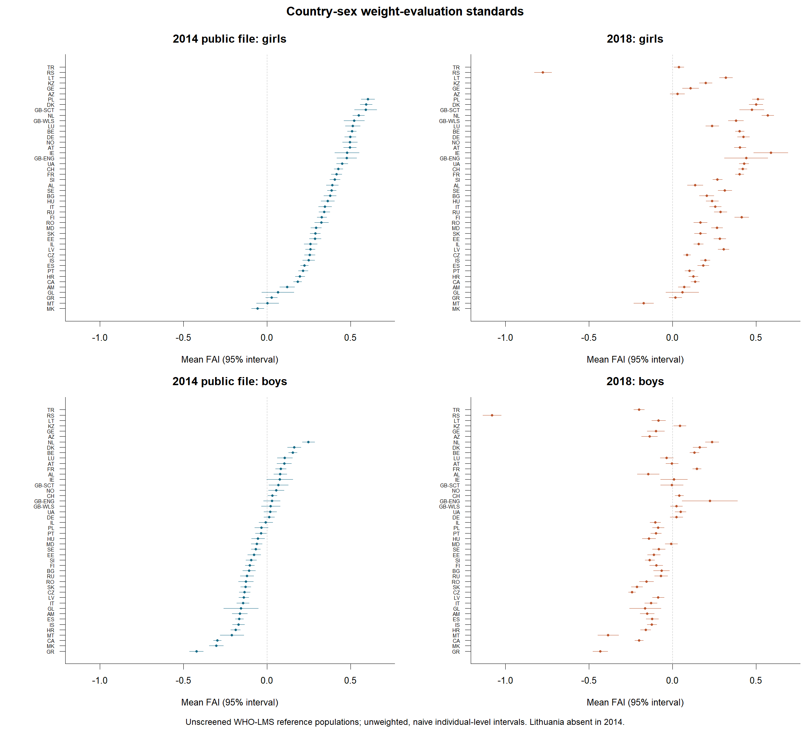
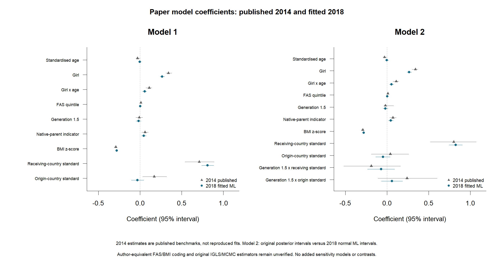

# HBSC replication assessment: 2014 verification and 2018 ML analysis

Updated 26 October 2026. Prepared for methodological discussion with the replication study lead; this is not a completed reproduction, final power submission, or approved preregistration. Sources: `paper_to_be_replicated.pdf` (Kern et al., 2020), `Secondary data power.pdf`, `Guidelines for Replicators.pdf` (13 August 2026), and the supplied 2014/2018 codebooks. The earlier methodological audit is retained below; the subsequently authorised full-sample 2018 ML analysis are reported in Section 8. The scope now excludes added sensitivity analyses, formal coefficient contrasts and power simulations; the previously requested PDF power benchmark is retained.

Output policy (27 October 2026): only this assessment, comparison2014_2018.csv, country_fai.png and models2018.png are retained in results/. Removed supporting tables remain reproducible in memory; their key findings are documented here. No participant data or fitted-object caches are written.

## Recommendation and scope

**Two essential decisions remain before a formal focal-power conclusion:**

1. **Confirm the COS-assigned focal effect.** The report shows both origin- and receiving-country associations, but the focal hypothesis has not been verified against the assigned preregistration. Confirm its exact wording and statistic; do not select the focal effect from the 2018 results.
2. **Obtain methodological approval for the power calculation.** The RPHB instructions require study-lead consultation for this cross-classified multilevel design. The reported power percentages are provisional and not adjusted for the multilevel structure. They cannot establish formal Tier 1 or Tier 2 eligibility until the method is approved.

The user's confirmation of editorial approval and OSF registration is recorded separately; no confirmation of these two specific decisions has been supplied. Until both are resolved, report the numerical power benchmarks without assigning a formal tier.

Use HBSC 2013/14 to check the original analysis and HBSC 2017/18 as the candidate independent-wave replication. Preserve the paper's conceptual definitions while implementing **wave-specific harmonisation**. The raw birthplace coding is not identical across waves and should not be forced into a common recode. The 2001, 2006 and 2010 releases remain excluded and are no longer tested.

**HBSC 2013/14:** Reproduction is pending recovery and validation of the national birthplace mappings and the authors' sample-selection procedure. The released categories establish some native/foreign distinctions, but the supplied generic dictionary alone does not identify the countries behind all national choices. This is a documentation/release limitation, not proof that the paper's approach cannot be reproduced.

**HBSC 2017/18:** The ISO-based ML implementation has now been run on 13,884 complete cases, using only the paper's two model structures (Section 8). It estimates the receiving association at 0.811 [0.739, 0.883] and the origin association at -0.031 [-0.105, 0.044]. This is an explicitly approximate replication of the conceptual origin rule, not an exact reimplementation of the original estimators. Usability depends on country-specific availability, valid country-sex standards, harmonised covariates, sample independence and an agreed design. Incomplete 2014 reproduction does not automatically disqualify 2018 under the replicator guidelines.

The COS-assigned focal claim must be confirmed from the supplied preregistration document and retained. The article's Hypothesis 1 concerns both positive contextual associations and a stronger receiving association; Hypothesis 2 concerns generation moderation. Origin/receiving/contrast labels below describe candidate statistics, not a decision to change the assigned claim.

## 1. Paper-based method and wave-specific birthplace audit

Sections 2.2.2-2.2.3 of the paper define migration background as the respondent or at least one parent born outside the survey country. Foreign-born respondents are generation 1.5. Respondents born in the receiving country with a foreign-born parent are second generation. Origin is own birthplace for generation 1.5; for second generation use maternal birthplace, falling back to paternal birthplace when maternal birthplace is unknown or receiving country. Receiving country is survey country.

| Component | HBSC 2013/14: required implementation | HBSC 2017/18: required implementation |
|---|---|---|
| Released birthplace fields | `m133`, `m134`, `m135`: national categories 1-6 | `countryborn`, `countrybornmo`, `countrybornfa`: ISO-labelled strings |
| Native birthplace | Category 1 denotes resident country; validate national exceptions | Compare documented birthplace code with harmonised receiving-country code |
| Named foreign birthplaces | Categories 2-5 require receiving-country-specific national labels; verify labels for each birthplace field | Validate actual ISO codes and geographic exceptions against documentation |
| Residual foreign category | Category 6 is another country: foreign status can be known while exact origin remains unresolved | Broad or residual codes can still lack the detail needed for a contextual standard |
| Origin assignment | Decode first, then follow the paper's own/maternal/paternal hierarchy | Harmonise ISO geography first, then follow the same hierarchy |
| Eligible origin | Require a participating origin with an available sex-specific FAI standard | Apply the analogous rule using documented 2018 coverage; do not assume identical country lists |

The supplied 2014 dictionary (printed pp.123-125) gives generic national-choice labels, not the national country crosswalk. Request national questionnaires/appendices or the authors' crosswalk, keyed by survey country, birthplace field and released value. Recoverable categories 2-5 must not be discarded merely because they are not ISO codes. Do not assign category 6 an invented country or assume it represents only non-HBSC origins. Whether the authors excluded it or recovered additional detail is unknown from the supplied article; more detailed data may be needed, but that has not been established as the only solution. All origins need not be known to construct a documented eligible subset, although matching the published subset requires matching the authors' rules.

The paper documents the conceptual assignment hierarchy, not a universal raw-variable conversion or evidence that the authors used precisely this public release. Obtain clarification rather than infer restricted access or a specific recode from the published N.

UK constituent nations are retained to match the paper. The previously added combined-GB sensitivity has been removed. Belgium's two survey regions are combined as BE. Broad GB in the detailed specification remains unresolved where a constituent nation is required. The current decision not to use paternal fallback for an ambiguous broad-GB maternal code is conservative and needs explicit review against the paper's fallback for unknown maternal origin. Missing respondent birthplace also needs an agreed generation rule; the current code leaves generation unresolved. Preserve `NA` as Namibia's ISO code, not a missing-value string.

## 2. Methodological audit of the current R implementation

| Item | Paper specification / current evidence | Audit finding and required resolution |
|---|---|---|
| Outcome | FAI = perceived status minus WHO-based actual status; range -4 to +4 (Section 2.2.1) | Formula and ordered perceived categories implemented; author-equivalent WHO convention not verified |
| WHO scoring | Current code uses WHO 2007 LMS, age-in-months interpolation and tail adjustment | Checks against official worked examples support this implementation, not equivalence to the authors' code |
| Plausibility exclusions | Latest primary verification/2018 fit has no extra z screen; [-5,5] is sensitivity | Screen is not documented in the paper. Primary data retain extreme WHO scores; screened estimates are therefore reported alongside them, without claiming author equivalence |
| BMI covariate | Section 2.2.5 describes BMI minus age/sex median divided by SD | Do not silently equate this with LMS; recover the authors' implementation or justify the approximation |
| FAS III | Six-item composite, country/age/sex percentiles grouped into quintiles (Section 2.2.4) | Now implemented for 2018 using 0-based item sum and country/age-category/sex midrank quintiles; exact author age grouping, weights and tie convention remain unverified |
| Age | Table 4 marks age standardised | 2018 uses complete-sample age z-score and matching age-by-girl interaction; author convention remains unverified |
| Contextual standards | Country-sex mean FAI from the full reference population before immigrant restriction (Section 2.2.6) | Current diagnostic follows this order. Person- and country-weighted grand centring are both tabulated; original convention unresolved |
| Native-parent indicator | Paper says one of the parents born in receiving country | Current OR rule means at least one known native parent; review whether exactly one was intended and how unknown parents were handled |
| Original sample flow | 166,798 reference records; 14,024 migration-background records; 8,638 participating origins; 514 exclusions; final 8,124 (Section 2.1) | Existing all-file migration counts use a different filtering stage. Reconcile sequentially after mapping and reference eligibility; differences are not direct evidence of failed reproduction |
| Country coverage | Paper includes Lithuania among 41 country units | Supplied 2014 diagnostics have 40 units after pooling Belgium; Lithuania absent. Document the release difference and obtain its data or assess reduced coverage explicitly |
| Model 1 | Cross-classified receiving/origin effects; Stata IGLS (Section 2.3) | 2018 now fitted with lme4 ML; original 2014 fit remains unresolved and estimator equivalence is not claimed |
| Model 2 | Adds generation-by-origin and generation-by-receiving interactions; MLwiN MCMC | 2018 now fitted with both interactions using ML rather than MCMC; original sampler/prior settings remain unresolved |
| Inference | Country dependence, survey design and generated contextual means | Only the paper's model coefficients are retained; the added formal coefficient contrast has been removed. Normal intervals and method equivalence remain limitations |
| Final eligibility | Complete individual covariates plus valid origin/receiving standards | The earlier screened count is 13,858; the implemented unscreened primary ML sample is 13,884. Country-sex precision, missingness and method equivalence still require review |

## 3. Existing descriptive checks against the paper

These checks reuse previous outputs. They are not a new full-sample analysis or a reproduction of the immigrant regression sample.

| Statistic | Paper | Existing 2014 diagnostic | Interpretation |
|---|---:|---:|---|
| Reference-population N | 166,798 | 163,139 (no added z screen) | Difference -3,659; release/scoring differences unresolved |
| Reference geographic units | 41 | 40 | Lithuania absent from supplied release after Belgium pooling |
| Lowest boys' country mean | Greece, about -0.4 | GR, -0.423 | Descriptive country/magnitude comparison |
| Highest girls' country mean | Poland, about +0.6 | PL, 0.603 | Descriptive country/magnitude comparison |
| Girls' mean exceeds boys' | All 41 countries, significant in paper | Positive difference in all 40 available countries | Direction checked; significance not reproduced |
| Shared country variance by sex | About 68% | 71.3% squared Pearson correlation | Different coverage; not an exact reproduction |
| Final immigrant N | 8,124 | Not reconstructed | Requires wave-specific mappings and matched selection |
| Immigrant FAI mean (SD), Table 3 | 0.19 (0.89) | Not evaluated on matched sample | Full-reference means cannot substitute for immigrant statistics |

Official reference sources used previously: [WHO BMI-for-age tables](https://www.who.int/tools/growth-reference-data-for-5to19-years/indicators/bmi-for-age) and [LMS computation instructions](https://cdn.who.int/media/docs/default-source/child-growth/growth-reference-5-19-years/computation.pdf). The cached `data/who2007_bmi_lms.csv` stores Month/L/M/S from the boys/girls expanded tables downloaded on 26 October 2026. These sources establish the WHO method, not the authors' undocumented software choices.

## 4. Approximate power using the 2018 candidate sample

At the user's request, the standard-regression recipe in [the linked RPHB power guidance](https://docs.google.com/document/d/1dg7GZqi1hwIEcXiAqmR7un-wL1V7K33yX3TQ3vHmCDk/edit?tab=t.0) is calculated below as an explicitly conditional preliminary benchmark. The user confirmed that this document and the supplied `Secondary data power.pdf` contain the same guidance; the local PDF is therefore the source used for this calculation. This calculation uses existing summary counts and published statistics only; no new participant outcomes or regression models are analysed.

**Two essential decisions remain:** (1) verify the exact COS-assigned focal hypothesis/statistic against the assigned preregistration; and (2) obtain study-lead methodological approval for the power calculation in this cross-classified multilevel design. Neither decision has been confirmed in the supplied materials. Until both are resolved, report the numerical benchmarks without assigning formal Tier 1 or Tier 2 eligibility.

**Status: provisional, not adjusted for the multilevel structure.** The guidelines require consultation with the study lead for this cross-classified multilevel design. No study-lead decision approving this power method has been recorded; editorial approval and OSF registration do not themselves establish that the power calculation is design-appropriate.

**COS-assigned focal effect: not documented in the supplied materials.** Confirm and insert the assigned effect/statistic from the COS preregistration before submitting a focal power conclusion. Both origin and receiving benchmarks are shown provisionally; neither is selected as focal on the basis of the 2018 findings. If COS assigned a different statistic, these two rows do not supply its power.

**Replication N = 13,884**, taken from the analysis-N row in comparison2014_2018.csv. Neither full-wave N=244,097 nor the descriptive reference N is used as the immigrant sample. Power is conditional on this analysis definition; methodological and independence limitations remain documented.

**Assumptions:** Model 1 has k=9 fixed-effect slopes, excluding intercept. For this benchmark only, original df=8,124-9-1=8114 and replication v=N-9-1=13874. These are independent-observation regression df, not established effective multilevel df. Original SE=rounded CI width/(2*qnorm(.975)); t=abs(beta/SE); partial r=t/sqrt(t^2+original_df). Both origin and receiving candidates are reported without choosing or changing the COS-assigned claim. No contrast power is calculated because coefficient covariance is unavailable.

| Model 1 candidate | Beta | Approx. SE | Approx. partial r | Tier 1: 75% of r | Tier 2: 100% of r |
|---|---:|---:|---:|---:|---:|
| Origin | 0.17 | 0.07398 | 0.02550 | 61.54% | 85.19% |
| Receiving | 0.71 | 0.08929 | 0.08794 | 100.00% | 100.00% |

The PDF recipe uses alpha=.05, r_tier1=.75*r_original, r_tier2=r_original, f2=r^2/(1-r^2), and pwr::pwr.f2.test(u=1,v=v,f2=f2,sig.level=.05). Base R computes the equivalent noncentral F power, with ncp=f2*(u+v+1); equivalence is checked against pwr/effectsize when those packages are installed. Tier targets are 90% and 80%, respectively. Displayed 100.00% values are rounded, not certainty.

**Why report the 75% benchmark?** Tier 1 asks whether the replication can detect an effect smaller than the originally reported estimate: 75% of the original partial correlation, with a 90% power target. Tier 2 assesses the full original partial correlation with an 80% power target. Reporting only full-effect power would omit this smaller-effect criterion.

**Interpretation:** Compare the displayed powers against 90% (Tier 1) and 80% (Tier 2). These numbers do not establish RPHB tier qualification. Country-level information, cross-classification, survey clustering/weights and generated contextual means are not accounted for. Approximate partial r and usable N require review. Added simulation analyses are excluded from the current scope. The PDF explicitly requires study-lead escalation for this non-standard design. Changing original df also changes converted r, so this is not a conservative or design-adjusted power estimate.

### Four design questions and two validity questions

1. **Nested/multilevel observations? YES.** The paper cross-classifies origin and receiving countries; schools/classes add possible dependence.
2. **Complex sample design? YES.** Weights and cluster identifiers exist; their appropriate analysis use needs confirmation.
3. **Mediation/SEM? NO** for the Model 1 coefficient candidates. Confirm the assigned statistic before finalising.
4. **Rare-event/count outcome? NO.** FAI is a bounded difference score.
5. **Original covariates unavailable?** In 2018, candidate age, sex, six FAS items and anthropometry exist; derived FAS/WHO variables remain unvalidated. The 2014 birthplace issue concerns recovering the origin predictor and eligible sample, not missing birthplace questions altogether. Resolve construct validity and justify deviations before calling the 2018 test high quality.
6. **Independent cases/units? UNKNOWN.** Different waves do not prove no repeated respondents. Establish overlap and exclude original respondents as required; repeated countries/schools are a separate dependence issue. Recompute usable N after applicable exclusions.

## 5. Outstanding tasks and questions for the study lead

**This assessment is ready for methodological consultation now, not submission as a completed power analysis.** Unresolved inputs are reasons to request guidance, not reasons to postpone contacting the lead until all issues are solved. No communication has been sent.

| Priority | Task / decision | Evidence needed |
|---|---|---|
| 1: lead/COS | Confirm the already assigned focal claim and statistic; retain it | COS-provided preregistration wording |
| 1: lead/editor | Disclose prior full-sample descriptive exposure and agree the permitted next steps | Written handling decision; actual editorial/OSF status |
| 1: provider/authors | Recover 2014 national mappings, category-6 treatment and original eligibility rules | Country-by-field crosswalk, author code/clarification; determine whether further data are necessary |
| 1: lead | Agree effect-size conversion and complex-design power method | Appropriate df/estimand or justified alternative; contrast covariance if relevant |
| 2: analyst/provider | Validate 2018 ISO codes and country participation; resolve broad GB and missing birthplace cases | Country-specific coverage and missingness rules; preserve the paper's detailed UK units |
| 2: analyst/authors | Resolve WHO/BMI covariate scoring, plausibility rules, FAS quintiles, age scaling and centring | Frozen harmonisation dictionary and discrepancy log |
| 2: analyst/provider | Assess licence, respondent overlap and school/country dependence | Permitted-use documentation, independence assessment and exclusions |
| 2: analyst | ML approximation implemented and validated; resolve exact-method differences | Section 8 provides the sample and both model structures; author-equivalent estimators and design adjustments remain outstanding |
| 2: analyst | Build deterministic random-5% code-testing mode with evidence | Seed, eligible sampling frame, test size and checks; avoid a new full-sample outcome run |
| 3: analyst/lead | Complete approved Tier 1/Tier 2 power and report usable N/design | Numerical estimates, assumptions, uncertainty and sensitivity where appropriate |
| 3: team | Complete COS Google Doc, editorial review and OSF registration | Version-of-record document, approval evidence and registration URL/date |
| After approval/registration | Run final full-sample analysis and report outputs | Registered specification, estimates/intervals, deviations and linked permitted materials |

Exact reproduction of Tables 1-4 remains a separate original-data check. It should follow the paper's rules with a 2014-specific mapping, not reuse 2018 ISO parsing. A valid 2018 replication can still provide diagnostic evidence when original reproduction remains incomplete, subject to a justified design and required review.

## 6. Transparency and workflow status

`Guidelines for Replicators.pdf` (pp.1-3, 7) prioritises a good-faith diagnostic test of the fixed claim rather than identical data structures. It requires explicit treatment of population, construct validity, unavailable controls and overlap. The COS-provided Google Doc is the preregistration version of record; this local assessment does not replace it.

**Prior exposure:** full-file 2018 migration counts, WHO-based FAI outcomes, country-sex means and the candidate input count have already been inspected. The 2018 ML models are reported in Section 8; their approximation to the paper is explicit. The user has now confirmed editorial approval and OSF registration are complete; URLs, dates and timing relative to the earlier descriptive exposure are not recorded. These outputs must not be labelled results-blind or prospectively preregistered. The full-sample descriptive work preceded local review of the guidelines' 5% restriction; its timing relative to the confirmed approval/registration remains unknown. Preserve the exposure history for COS/editor; a later 5% test cannot undo it.

Page 4 requests testing code on a random 5% of the replication sample and prohibits full-sample analysis before editorial approval and OSF registration. No documented 5% test exists; WHO worked-example checks are not a substitute. Following the 2014 verification, the user requested 2018 replication and power; use --replicate-2018 for the ML analysis and simulations or --verify-2014 for the isolated original-wave check. The `--power-only` entry point now updates only the approximate-power section using published evidence and the existing candidate-N summary, without reading participant files or rerunning outcome analyses. The earlier audit used existing outputs and documents; Section 8 records the subsequent full-sample analysis requested by the user.

The supplied guidelines request a draft within two weeks of receiving the COS document, OSF registration within one week of editorial approval, a final report within three weeks of registration, and reporting/upload within two weeks of completing analyses. The document's firm final deadline is 1 December 2026. Receipt/approval/registration dates are unknown; personal milestones cannot yet be calculated. No current external schedule has been verified.

Contact in the supplied guidelines: replications@cos.io. No email, Google Doc change, OSF registration or upload has been performed. Sharing remains subject to data access/licence conditions. This assessment is a reviewed preliminary document for discussion; numerical power, preregistration and final replication remain unfinished.

## 7. Original-wave verification: 2014 only

Approval and registration were confirmed complete by the user in this conversation. URLs/dates have not been supplied. Following the user's latest instruction, this run verifies only 2014 and does not analyse 2018 participant records.

**Release difference verified in the supplied codebook:** p.4 explicitly states that OA edition 1.1 removed Lithuanian data. This is a documented release difference, not just an inferred absent code. The article includes Lithuania in its reference population and Table 2. Matching all original observations therefore needs an appropriate authorised release or the missing national data, as well as the birthplace crosswalk.

**Import checks passed:** 214,080 records, unique respondent IDs, and seven observed nonmissing counts match the codebook: perceived weight 201,130; bodyweight 183,730; bodyheight 183,139; age 212,226; own/maternal/paternal birthplace 127,661 / 126,164 / 125,628. Sex and perceived-weight values match documented categories. There are 41 raw survey-country codes but 40 units after combining Belgian regions.

| Verification stage | Observed 2014 N |
|---|---:|
| Valid reference FAI; no extra z screen | 163139 |
| Valid reference FAI; provisional [-5,5] screen | 162882 |
| Known migration background; all imported | 26698 |
| Known migration background with valid FAI | 18556 |
| Generation 1.5; all imported | 8253 |
| Second generation; all imported | 18332 |

Relative to the paper's reference N=166,798, the unscreened WHO-LMS construction is short by 3659. The extra provisional z screen removes a further 257 records. Missing Lithuania could contribute to the former gap, but neither its complete-case N nor the original scoring/exclusions are available to prove exact reconciliation. The primary line of this verification therefore applies no additional undocumented z exclusion; the previous screened table is retained as sensitivity, not relabelled as the paper's method.

The all-file migration counts above are not the paper's selected N=14,024, nor are the generation counts comparable to its final 2,603 / 5,521 until exact-origin and complete-case restrictions are applied. Countries with migration questions but no eligible participating origins can disappear after selection. No origin country is inferred from category rank.

**Additional receiving-country inconsistency:** Table 1 reports 333 eligible immigrants in the Republic of Moldova. The supplied file yields zero known migration-background records for MD under the generic dictionary's 1=native, 2-6=foreign coding. Thus a national crosswalk for codes 2-5 alone cannot be presumed to resolve every sample difference. Ask the provider/authors about the national raw coding and release processing, and verify any national exception before recoding.

With naive individual-level 95% t intervals, girls' means are above zero in 36 of 40 available countries; boys' means are above zero in 10 and below zero in 23. The paper reports 37/41 for girls and 9/41 above, 24/41 below for boys. These are diagnostic counts only: coverage differs and the paper's exact interval/design convention is not verified.

**Verification outcome:** released-data integrity and partial reference-population patterns are checked. Tables 1-4 are not verified. The concrete missing inputs are (1) an authorised 2014 release including Lithuania, (2) national birthplace labels for m133/m134/m135 choices 2-5 and original category-6 treatment, and (3) author-equivalent WHO/exclusion, FAS and estimation settings. Searches of available public material did not recover a verified national crosswalk. The official data-provider page was inaccessible to the browsing tool; this is not evidence that the mappings do not exist. No external messages or restricted-data requests were sent.

## 8. Full-sample 2018 replication under documented approximations

Approval and OSF registration were confirmed complete by the user; identifiers/dates remain unrecorded. The user requested 2018 analysis after the 2014 check. The original 2014 models remain unreproduced: effect and variance inputs below come from published Table 4, not from a fitted 2014 reproduction.

**Primary 2018 model N=13884**, with 32 receiving and 43 origin countries. The primary outcome uses WHO LMS with no extra z screen, following the latest 2014 verification; the earlier screened N=13,858 is a superseded diagnostic count, not this model N.

**Explicit approximations fixed before these fits:** unweighted reference means including immigrants; person-weighted sex-specific grand centring; six FAS items recoded from 1-based to 0-based and summed; country x age-category x sex midrank percentiles, quintiles ceiling(5*p) preserving ties; age z-standardised within each complete analysis sample; at-least-one-known-native-parent coding; missing own birthplace/generation unresolved; detailed UK geographic units matching the paper. The age-category rather than exact-age FAS stratification is an approximation requiring methodological review. The same sample is used for Models 1 and 2.

Model 1 and Model 2 both use lme4 maximum likelihood, retaining origin and receiving random intercepts. Model 2 adds both generation interactions but is NOT the paper's Bayesian MLwiN MCMC model. Intervals/p-values are asymptotic normal approximations, without survey-weight or school-cluster correction. These are implemented temporal-replication estimates under stated assumptions, not an exact reproduction of the original estimators.

| Model | Term | Estimate | 95% interval | Normal p |
|---|---|---:|---|---:|
| Model 1 ML | receiving_standard | 0.811 | [0.739, 0.883] | 0.0000 |
| Model 1 ML | origin_standard | -0.031 | [-0.105, 0.044] | 0.4178 |
| Model 2 ML approximation | receiving_standard | 0.825 | [0.746, 0.903] | 0.0000 |
| Model 2 ML approximation | origin_standard | -0.049 | [-0.135, 0.036] | 0.2581 |
| Model 2 ML approximation | receiving_standard:generation15 | -0.072 | [-0.234, 0.089] | 0.3797 |
| Model 2 ML approximation | origin_standard:generation15 | 0.059 | [-0.068, 0.185] | 0.3634 |

For this primary ML approximation, the receiving-country association is positive and its interval excludes zero; the origin-country interval includes zero. This supports the receiving component in this specification, but does not reproduce the paper's positive origin finding. The Model 2 interaction intervals must be interpreted jointly with their estimation differences; lack of significance is not evidence that effects are identical across generations.

Model 1 variance components: origin=0.00077; receiving=0.00034; Residual=0.59221. Singular fits: Model 1=FALSE, Model 2=FALSE. Inspect the convergence/singular columns in the full model table; a boundary origin variance is retained, not silently dropped.

### Outputs and limits

[Published 2014 and fitted 2018 comparison table](comparison2014_2018.csv)

Scope is restricted to the paper's two model structures and reporting tables. Additional sensitivity models, generated-regressor variants and simulation power have been removed at the user's request. Differences in significance between waves are not themselves a test of temporal change. No causal interpretation is warranted. Exact 2014 verification, author-equivalent FAS/BMI conventions, Bayesian Model 2 and survey/school-adjusted inference remain unresolved; this run completes the documented ML approximation rather than those outstanding methods.

## 9. Side-by-side comparison: published 2014 and fitted 2018

**2014 values are published benchmarks from Kern et al. Tables 1-4, not reproduced estimates.** The 2018 values are from the primary unscreened complete-case ML specification. Mean (SD) is shown for descriptives; regression cells show coefficient [95% interval]. The 2014 Model 2 intervals are Bayesian posterior intervals; all 2018 intervals are normal ML approximations.

### Sample and descriptives

| Statistic | Published 2014 | Fitted 2018 |
|---|---|---|
| Analysis N | 8124 | 13884 |
| Receiving countries | 23 | 32 |
| Origin countries | 41 | 43 |
| Generation 1.5 N | 2603 | 4109 |
| Second generation N | 5521 | 9775 |
| Girls (%) | 51 | 50.71 |
| FAI mean (SD) | 0.19 (0.89) | 0.07 (0.88) |
| Age mean (SD) | 13.83 (1.65) | 13.67 (1.66) |
| FAS quintile mean (SD) | 3.09 (1.43) | 3.11 (1.41) |
| BMI z-score mean (SD) | -0.01 (1.22) | 0.05 (1.27) |

### Model 1

| Statistic | Published 2014 | Fitted 2018 |
|---|---|---|
| Standardised age | -0.030 [-0.050, 0.000] | -0.003 [-0.021, 0.015] |
| Girl | 0.340 [0.310, 0.380] | 0.266 [0.240, 0.292] |
| Girl x age | 0.110 [0.070, 0.140] | 0.055 [0.029, 0.080] |
| FAS quintile | 0.010 [0.000, 0.020] | 0.004 [-0.005, 0.013] |
| Generation 1.5 | -0.010 [-0.050, 0.030] | -0.018 [-0.047, 0.012] |
| Native-parent indicator | 0.060 [0.020, 0.100] | 0.046 [0.017, 0.074] |
| BMI z-score | -0.290 [-0.310, -0.280] | -0.280 [-0.290, -0.270] |
| Receiving-country standard | 0.710 [0.540, 0.890] | 0.811 [0.739, 0.883] |
| Origin-country standard | 0.170 [0.030, 0.320] | -0.031 [-0.105, 0.044] |

### Model 2

| Statistic | Published 2014 | Fitted 2018 |
|---|---|---|
| Standardised age | -0.030 [-0.050, 0.000] | -0.003 [-0.021, 0.016] |
| Girl | 0.340 [0.300, 0.370] | 0.266 [0.240, 0.292] |
| Girl x age | 0.110 [0.070, 0.140] | 0.054 [0.029, 0.080] |
| FAS quintile | 0.010 [0.000, 0.020] | 0.004 [-0.005, 0.013] |
| Generation 1.5 | -0.020 [-0.040, 0.080] | -0.019 [-0.049, 0.011] |
| Native-parent indicator | 0.070 [0.030, 0.110] | 0.045 [0.016, 0.074] |
| BMI z-score | -0.290 [-0.310, -0.280] | -0.280 [-0.290, -0.270] |
| Receiving-country standard | 0.800 [0.520, 1.070] | 0.825 [0.746, 0.903] |
| Origin-country standard | 0.040 [-0.190, 0.260] | -0.049 [-0.135, 0.036] |
| Generation 1.5 x receiving standard | -0.190 [-0.520, 0.160] | -0.072 [-0.234, 0.089] |
| Generation 1.5 x origin standard | 0.240 [-0.110, 0.600] | 0.059 [-0.068, 0.185] |

2018 retains more origin/receiving countries and uses documented FAS, age-scaling and BMI assumptions. Table differences therefore combine population, measurement and estimation differences. Model 2 main contextual effects refer to second-generation adolescents (generation 1.5 indicator=0). Neither differing point estimates nor significance in one wave alone establishes temporal change; a dependence-aware cross-wave test is required. 

[Download the comparison table](comparison2014_2018.csv). This table is generated from existing model/descriptive outputs and transcribed published benchmarks; no models were rerun.

## Standalone power-code audit — 5 November 2026

The standalone noncentral-F calculation matches the installed pwr package; the independent noncentral-t check agrees within 1e-6. Published beta/CI inputs match Table 4, and tier fractions are applied to partial r before conversion to f2, as the power PDF specifies. The replication predictor override has been corrected: original_k=9 is now separate from replication k, so changing the replication model does not change the original partial-r estimate. Default numerical results are unchanged.

This verifies numerical implementation, not design validity. The CI-derived SE is approximate; original denominator df is assumed rather than recovered from the multilevel model. The contextual effects are shared within countries/country-sex units, so individual N alone is insufficient to establish cross-classified model power. COS focal-effect confirmation and study-lead method approval remain necessary. No raw-data analyses or models were rerun in this audit.

## Input provenance and reproducible HBSC2018 preprocessing — 5 November 2026

The independent power script now has a separate preprocessing section and derives the sample size from `HBSC2018OAed1.1.csv`. Providing a dataset eliminates the need to guess observed sample counts or missingness. It does not establish undocumented author choices or turn an independent-person power formula into a multilevel method.

| Input | Value / implementation | Source and status |
|---|---|---|
| Imported 2018 records | 244,097 | Counted from the provided CSV; not power N |
| Valid FAI reference records | 181,999 | Derived from age, sex, perceived status and WHO-reference anthropometry, before immigrant restriction |
| Known migration background | 32,654 | Derived from respondent/parent ISO codes; unknowns are not treated as native |
| Migrant records with both country-sex standards | 21,808 | Derived using the wave-specific reference population |
| Complete analysis sample | 13,884 | Derived after valid FAI, origin/receiving standards and all model covariates |
| Receiving / origin groups | 32 / 43 | Counted within the derived analysis sample |
| Model 1 predictor count k | 9 | Paper Section 2.3 specifies the terms; counted/checked in the full-rank fixed-effect design matrix |
| Original study N | 8,124 | Published paper Section 2.1/Table 4, not the 2018 dataset |
| Origin beta, 95% CI | .17 [.03, .32] | Published Table 4, Model 1 |
| Receiving beta, 95% CI | .71 [.54, .89] | Published Table 4, Model 1 |
| Alpha; tier fractions; targets | .05; .75 / 1.00; .90 / .80 | Supplied Secondary data power.pdf |
| Original df=8,114 | 8,124-9-1 | Explicit independent-observation assumption; not recovered from data or validated for the original multilevel model |
| WHO/FAS/centring conventions | LMS with interpolation/tail adjustment; country/age-category/sex midrank FAS quintiles; person-weighted centring | Existing implementation choices. Paper specifies the constructs but does not resolve every convention |

Preprocessing imports semicolon-separated, decimal-comma data, handles a UTF-8 BOM, checks wave/IDs/required fields, preserves NA=Namibia, computes BMI/WHO scores/FAI, applies the paper's migration/origin hierarchy at detailed UK geography, builds reference means before immigrant restriction, constructs six-item FAS quintiles, then uses complete cases and standardises age. It reproduces the existing analysis N without fitting regression models. The source code labels FAS age-category stratification, tie handling, broad-GB rules and at-least-one-native-parent coding as implementation choices rather than dataset-established facts. No new exclusion threshold, sensitivity model or analysis output is introduced.

**No silent power assumptions:** default execution now derives sample flow only. The user must explicitly request `--benchmark` to reproduce the Section 4 independent-observation approximation. The calculation function requires an explicit original_df instead of silently substituting N-k-1. The benchmark flag uses the previous 8,114 assumption and remains provisional; it is not proof that the assumption is justified. A design-appropriate power method and the COS focal effect still require confirmation. These changes supersede the earlier sample-size CLI overrides and no-data-input description of the standalone script.
